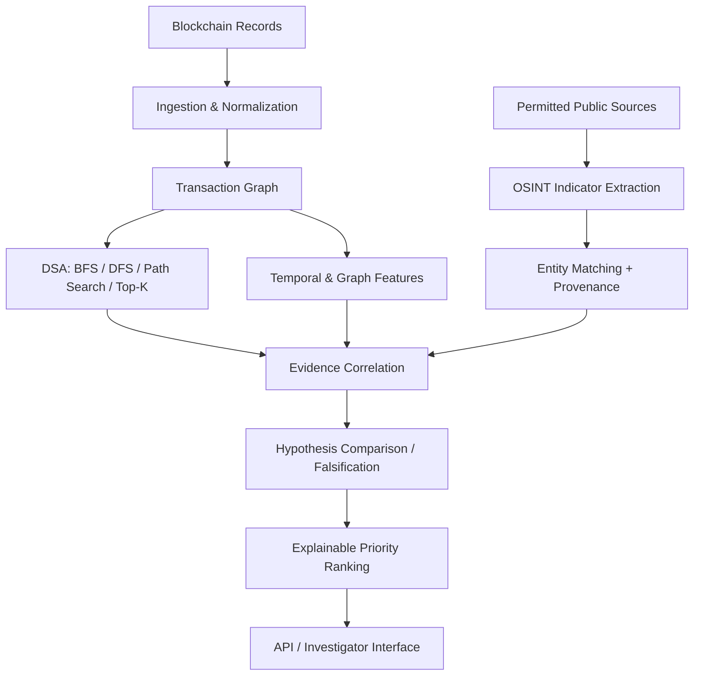

# 🕵️ ASTRA

## Quantitative OSINT Blockchain Intelligence Engine

<p align="center">
  <b>HACKFORGE 2026 — ADVANCED TRACK</b><br/>
  <sub>Ghost Attacks • Blockchain Intelligence • Evidence-Driven Investigation</sub>
</p>

<p align="center">
  
  
  
  
  
</p>

---

# 🏆 Competition

## HACKFORGE 2026 — ADVANCED TRACK

**Project:** ASTRA — Quantitative OSINT Blockchain Intelligence Engine

**Track:** Advanced Track — Ghost Attacks

**Team:** [TwoPointers]

### Team Members

- Rahul Sharma  — Blockchain Data & API Engineer
- Tejaswee Rajput— Quantitative Intelligence, OSINT & Evidence Engineer
- Sohana Pilli — Product UI/UX & Integration Engineer

---

# 🚨 The Problem

Blockchain transactions are public, but reconstructing meaningful investigative narratives from them remains difficult.

Investigators must explore transaction networks, trace fund flows, identify suspicious patterns, and correlate on-chain activity with fragmented public-source information.

Key challenges include:

- Large transaction graphs and complex fund-flow paths.
- Public-source indicators scattered across reports and repositories.
- Ambiguous matches between public mentions and blockchain entities.
- Missing, stale, or contradictory evidence.
- Manual investigation workflows that are slow and difficult to reproduce.
- The risk of treating suspicious patterns as proof of identity or wrongdoing.

The fundamental question is:

> **How can investigators prioritize suspicious blockchain activity and correlate it with traceable public-source evidence without overstating what the data proves?**

---

# 💡 Our Solution

**ASTRA** is a quantitative blockchain intelligence engine that combines transaction-graph analysis, temporal features, OSINT indicator matching, and explainable investigative prioritization.

The system helps investigators move from raw transaction activity to structured, reviewable investigative leads.

ASTRA combines:

- Directed transaction-graph analysis.
- Fund-flow path exploration.
- Temporal transaction fingerprinting.
- Data structures and algorithms integrated into the investigation engine.
- OSINT indicator extraction and entity matching.
- Source provenance and evidence freshness.
- Supporting and contradictory evidence.
- Competing-hypothesis comparison.
- Transparent investigative priority scoring.
- Missing-signal and uncertainty reporting.
- Sensitivity analysis and falsification checks.
- Reproducible evaluation and API integration.

ASTRA prioritizes leads. It does not independently prove identity, intent, or criminal activity.

---

# 🎯 Core Principle

ASTRA separates **observed data, analytical inference, and unresolved hypotheses**.

```text
INGEST
   ↓
NORMALIZE
   ↓
BUILD TRANSACTION GRAPH
   ↓
TRACE PATHS + EXTRACT TEMPORAL SIGNALS
   ↓
MATCH OSINT INDICATORS
   ↓
CORRELATE EVIDENCE
   ↓
RANK INVESTIGATIVE LEADS
   ↓
REVIEW LIMITATIONS + CONTRADICTIONS
```

Every important lead should retain its supporting signals, source references, assumptions, and uncertainty.

---

# 🔍 Investigation Workflow

```text
SELECT ENTITY / TRANSACTION
          ↓
EXPLORE TRANSACTION NEIGHBOURHOOD
          ↓
TRACE CANDIDATE FUND-FLOW PATHS
          ↓
ANALYSE TIMING + GRAPH STRUCTURE
          ↓
MATCH PUBLIC-SOURCE INDICATORS
          ↓
ASSESS SOURCE PROVENANCE
          ↓
COMPARE SUPPORTING / CONTRADICTING EVIDENCE
          ↓
CALCULATE EXPLAINABLE PRIORITY SCORE
          ↓
INVESTIGATOR REVIEW
```

---

# 🧮 DSA Inside the Investigation Engine

DSA is an internal implementation layer of ASTRA—not a separate user-facing feature.

| Algorithm / Structure | Role in ASTRA |
|---|---|
| Adjacency lists and hash maps | Efficiently index entities and transaction edges. |
| BFS | Explore bounded neighbourhoods and minimum-hop paths in unweighted graphs. |
| DFS | Perform controlled reachability and graph exploration. |
| Shortest-path search | Find candidate routes between entities. |
| Priority queues / heaps | Efficiently maintain Top-K investigative leads or paths. |
| Flow decomposition | Inspect branching fund movements while preserving transaction references. |
| Union-Find | Group connected components where symmetric relationships make this appropriate. |

### Correctness and Performance

- Bound graph traversal by hop, node, and edge limits.
- Handle cycles and disconnected components.
- Use documented cost functions for weighted path searches.
- Preserve transaction references and timestamps.
- Test outputs against small, hand-verifiable graph fixtures.
- Do not treat a path as proof of common ownership.

---

# 🕸️ Transaction Graph Intelligence

ASTRA models blockchain activity as a graph.

- **Nodes:** Wallet addresses or normalized entities, depending on the graph representation.
- **Directed edges:** Transfers with transaction references, timestamps, and available value or asset metadata.
- **Graph features:** Connectivity, neighbourhood structure, degree-related signals, and path relationships.
- **Temporal features:** Timing patterns and transaction sequences in the available data.

Graph proximity alone does not establish identity or common control. Cross-chain tracing depends on supported data and explicit linking evidence.

---

# 🌐 OSINT & Evidence Correlation

The OSINT layer turns public-source clues into traceable evidence candidates.

It supports:

- Extracting candidate wallet addresses and identifiers from supplied public-source text.
- Matching indicators against investigated entities.
- Preserving source URLs, source types, timestamps, and provenance metadata when available.
- Tracking supporting and contradictory evidence.
- Comparing competing hypotheses.
- Flagging weak matches, stale sources, and unresolved links.

### OSINT Ownership

**Person 1 — Source ingestion:** Connects permitted public-source providers and normalizes incoming records.

**Person 2 — OSINT analysis:** Validates indicators, matches entities, assesses provenance, correlates evidence with transaction activity, and identifies contradictions.

**Person 3 — Presentation:** Displays source links, evidence, timestamps, limitations, and unresolved findings in the interface.

**Important:** Indicator extraction and matching do not imply autonomous live-web crawling. Source connectors must be configured and validated. A public mention is not, by itself, proof that a person controls a wallet.

---

# 📊 Explainable Risk Prioritization

ASTRA produces a transparent **investigative priority score** to help prioritize analyst attention.

The score is not automatically a calibrated probability of illicit activity.

A lead should expose:

- Overall priority score and priority band.
- Contributing signal components.
- Available temporal and graph evidence.
- OSINT matches and source provenance.
- Contradictory evidence.
- Missing signals and signal completeness.
- Assumptions and limitations.

Missing inputs should be disclosed rather than silently treated as negative evidence.

---

# ⚠️ Handling Uncertainty & Edge Cases

| Challenge | ASTRA's Approach |
|---|---|
| Incomplete transaction data | Flag missing signals and limit conclusions. |
| Ambiguous OSINT matches | Preserve rationale and distinguish exact from weak matches. |
| Contradictory sources | Retain supporting and opposing evidence. |
| Cycles / disconnected graphs | Use visited sets and bounded traversal. |
| Shared services or mixers | Avoid equating transaction proximity with common ownership. |
| Unavailable source connectors | Report missing data or clearly labelled demo data. |
| Competing explanations | Compare hypotheses and identify unresolved evidence. |

> **A high-priority lead is a reason to investigate—not proof of identity or wrongdoing.**

---

# 🧪 Evaluation & Validation

ASTRA's evaluation should use reproducible data splits, explicit baselines, and metrics appropriate to class imbalance.

Recommended checks include:

- Precision, recall, F1, PR-AUC, and ROC-AUC for labelled classification tasks.
- Separate reporting for benign and suspicious classes.
- Baseline and feature-ablation comparisons.
- Tests for missing values, cycles, disconnected components, and invalid inputs.
- Reproducibility of graph paths and lead rankings.
- Sensitivity checks that remove or downgrade evidence.
- Runtime and memory measurements for graph operations.

Benchmark values should only be published when produced by the stated dataset and evaluation run. High overall accuracy alone can conceal poor recall on a rare class.

---

# 🧱 System Architecture



The architecture separates source ingestion, analysis, evidence correlation, ranking, and presentation.

---

# 🔌 API Surface

The Person 2 intelligence module has been designed around endpoints such as:

| Endpoint | Purpose |
|---|---|
| `GET /health` | Check service health. |
| `GET /model/info` | Inspect model or analysis metadata. |
| `POST /score/lead` | Score one investigative lead. |
| `POST /score/rank` | Rank multiple leads. |
| `POST /score/evidence` | Evaluate evidence-related inputs. |
| `POST /hypotheses/compare` | Compare competing hypotheses. |
| `POST /falsify` | Run evidence sensitivity or falsification checks. |
| `POST /features/temporal` | Calculate temporal features for supported inputs. |
| `POST /osint/extract` | Extract candidate indicators from supplied text. |
| `POST /osint/match` | Match supplied indicators against supported entities. |

Check the actual OpenAPI documentation at `/docs` for the exact request and response schemas in the version being run.

Endpoint availability does not mean live providers or autonomous crawling are configured.

---

# 🛠️ Technology Stack

## Intelligence & API

- Python 3.11+
- FastAPI
- Pydantic
- Pandas / NumPy
- scikit-learn and other model libraries where configured

## Graph & Algorithms

- Adjacency lists and hash maps
- BFS / DFS
- Shortest-path search
- Priority queues / heaps
- Flow decomposition
- Union-Find where appropriate

## Validation

- pytest
- Reproducible benchmark scripts
- Labelled scenarios and ablation tests

Confirm the repository's `requirements.txt` before assuming an optional dependency is installed.

---

# 🚀 Getting Started

## Prerequisites

- Python 3.11+
- Git
- ASTRA Person 2 project files
- Elliptic++ dataset files if running the transaction-model training pipeline

## 1. Clone the Repository

```bash
git clone <YOUR_REPOSITORY_URL>
cd <YOUR_REPOSITORY_DIRECTORY>
```

## 2. Create a Virtual Environment

**Windows PowerShell**

```powershell
python -m venv .venv
.\.venv\Scripts\Activate.ps1
```

**Windows Command Prompt**

```bat
python -m venv .venv
.venv\Scripts\activate
```

## 3. Install Dependencies

```bash
python -m pip install -r requirements.txt
```

## 4. Run Tests

```bash
python -m pytest -q
```

## 5. Start the API

```bash
uvicorn astra_intel.api:app --reload
```

Open the API documentation:

```text
http://127.0.0.1:8000/docs
```

Check service health:

```text
http://127.0.0.1:8000/health
```

## 6. Train the Transaction Model

Run this step if the required dataset files are available:

```bash
python -m astra_intel.train --data-dir data/ellipticpp --output-dir artifacts
```

Expected dataset files:

```text
data/ellipticpp/
├── txs_features.csv
├── txs_classes.csv
└── txs_edgelist.csv
```

The dataset is not included automatically. Use the actual filenames and paths in your local repository if they differ.

---

# 🧑‍🤝‍🧑 Team Work Division

## Person 1 — Blockchain Data & API

- Blockchain record ingestion and normalization.
- Transaction graph construction and fund-flow tracing.
- Shared schemas, API contracts, and provider reliability.
- Permitted public-source connectivity and source-record ingestion.

## Person 2 — Quantitative Intelligence, OSINT & Evidence

- OSINT indicator extraction, validation, entity matching, and provenance.
- Temporal feature engineering and graph metrics.
- DSA implementation inside the investigation workflow.
- Explainable ranking and score-component explanations.
- Supporting and contradictory evidence.
- Hypothesis comparison and falsification.
- Tests, benchmarks, and analytical documentation.

## Person 3 — UI/UX & Integration

- Investigator-facing graph, lead ranking, timeline, evidence, and report views.
- API wiring, loading/error states, and demo flow.
- Presentation of provenance, uncertainty, contradictions, and unresolved evidence.

All team members should align schemas and endpoint contracts before final integration.

---

# 🏁 Demo Workflow

```text
1. Start the ASTRA API
        ↓
2. Open /docs and check /health
        ↓
3. Submit a supported lead or transaction example
        ↓
4. Explore graph and temporal features
        ↓
5. Extract and match supplied OSINT indicators
        ↓
6. Inspect provenance and contradictions
        ↓
7. Compare hypotheses or run falsification checks
        ↓
8. Rank leads and review score explanations
        ↓
9. Run tests and record reproducible benchmark results
```

Use synthetic examples for unconfigured external integrations and label them clearly.

---

# 🏆 What Makes ASTRA Different?

A basic transaction explorer shows where funds moved.

ASTRA aims to connect the investigative steps:

```text
TRACE TRANSACTIONS
        ↓
FIND RELEVANT PATHS
        ↓
ADD TEMPORAL CONTEXT
        ↓
CORRELATE PUBLIC-SOURCE INDICATORS
        ↓
PRESERVE CONTRADICTORY EVIDENCE
        ↓
RANK LEADS TRANSPARENTLY
        ↓
SHOW WHAT IS KNOWN—AND WHAT IS NOT
```

Its core differentiator is **evidence-linked, explainable prioritization across transaction graphs and public-source intelligence**, with DSA implemented inside the engine rather than as a separate feature.

---

# 🎯 Final Vision

ASTRA aims to turn fragmented blockchain and public-source data into structured investigative leads that analysts can inspect, challenge, and reproduce.

> **Follow the money. Correlate the evidence. Expose the hidden network.**

### ASTRA

**Evidence over assumptions. Intelligence over fragmented data.**

---

<p align="center">
  <b>Built for HACKFORGE 2026 — ADVANCED TRACK</b><br/>
  <sub>Before publishing, update team names, repository links, dependencies, and benchmark values to match the final implementation.</sub>
</p>
